# ⚡ ProfileForge AI
### 🚀 Developer Career Intelligence & AI-Powered Portfolio Platform

<p align="center">
  
  
  
  
  
  
  
</p>

<p align="center">
  <b>Analyze Your Code. Optimize Your Resume. Showcase Your Skills. Accelerate Your Career.</b>
</p>

<p align="center">
  <a href="https://profileforge1.pages.dev">🌐 Live Application</a> •
  <a href="https://profileforge-ye6a.onrender.com/api/health">💚 API Health</a>
</p>

---

## 📌 About The Project

**ProfileForge AI** is an AI-powered developer career intelligence platform designed to help developers understand their GitHub profile, evaluate repository quality, identify technical strengths, and build a stronger professional presence.

The platform combines GitHub profile analysis, automated repository inspection, AI-assisted resume generation, ATS compatibility checks, job-description matching, personalized learning roadmaps, and shareable developer portfolios in one application.

With a modern React and TypeScript frontend and a Node.js and Express backend, ProfileForge AI provides an integrated workflow for transforming developer activity into actionable career insights.

### 🎯 What Makes ProfileForge AI Special?

- 🔍 **GitHub Intelligence:** Analyze contribution activity, repository metadata, coding technologies, and developer profile information.
- 🧠 **AI-Powered Career Insights:** Generate career recommendations using Google Gemini with a heuristic fallback engine.
- 📄 **AI Resume Builder:** Create structured, professional resume content tailored to developer skills and projects.
- 🎯 **ATS & Job Matching:** Compare resume information with job descriptions, identify missing keywords, and discover skill gaps.
- 🗺️ **Personalized Learning Roadmap:** Turn identified skill gaps into actionable learning recommendations.
- 🌐 **Developer Portfolio Generator:** Create shareable developer portfolio pages with customizable themes.
- 🚀 **Deployment Simulation:** Visualize build and deployment stages through a simulated deployment workflow and logs.
- 📊 **Code Quality Insights:** Evaluate repository health across maintainability, testing, security, and DevOps readiness.
- 🐳 **Containerized Architecture:** Use Docker and Docker Compose to package and run the application components.
- ☁️ **Cloud Deployment:** Host the frontend on Cloudflare Pages and the backend on Render.

---

## 🧭 1. Platform Overview — End-to-End Workflow

This diagram illustrates how a developer moves from GitHub profile analysis to career insights, resume optimization, and portfolio generation.

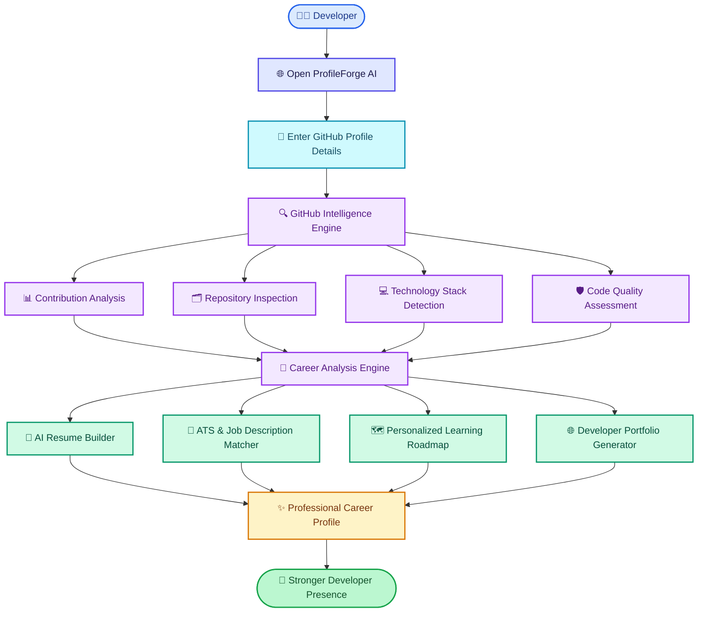

---

## ✨ 2. Core Features At A Glance

| Feature | Description |
|---|---|
| 🔍 GitHub Analyzer | Inspects contribution activity and repository metadata |
| 💻 Tech Stack Detection | Identifies technologies from repository information |
| 📊 Repository Health | Evaluates maintainability, testing, security, and DevOps readiness |
| 📄 AI Resume Builder | Generates structured resume content from developer information |
| 🎯 ATS Matcher | Compares resume information against a job description |
| 🧩 Skill Gap Analysis | Highlights matched and missing skills |
| 🗺️ Learning Roadmap | Recommends learning actions based on identified gaps |
| 🌐 Portfolio Generator | Creates shareable, theme-based developer portfolios |
| 🚀 Deployment Simulator | Demonstrates build and deployment stages through simulated logs |
| 🤖 AI Fallback Engine | Provides heuristic analysis when Gemini is unavailable |

---

## 🔄 3. Developer Career Intelligence Pipeline

ProfileForge AI organizes developer information into a workflow that converts raw profile and repository data into useful career outputs.

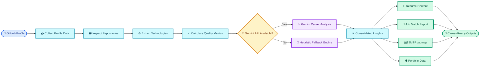

---

## 🛠️ 4. Technology Stack

### Frontend

- ⚛️ React 19
- 🔷 TypeScript 5.x
- ⚡ Vite
- 🎨 Tailwind CSS
- 🎬 Framer Motion
- 🧭 React Router DOM
- 🌐 Axios
- 🎯 Lucide React

### Backend

- 🟢 Node.js
- 🚂 Express 5
- 🕸️ Cheerio
- 🤖 Google Gemini API
- 🧩 Heuristic AI fallback engine
- 🗂️ JSON-based persistence using `fs-extra`
- 🔐 CORS and request middleware

### DevOps & Deployment

- 🐳 Docker
- 📦 Docker Compose
- 🌍 Cloudflare Pages
- ☁️ Render
- 🔄 Git-based continuous deployment

---

## 🏗️ 5. High-Level System Architecture

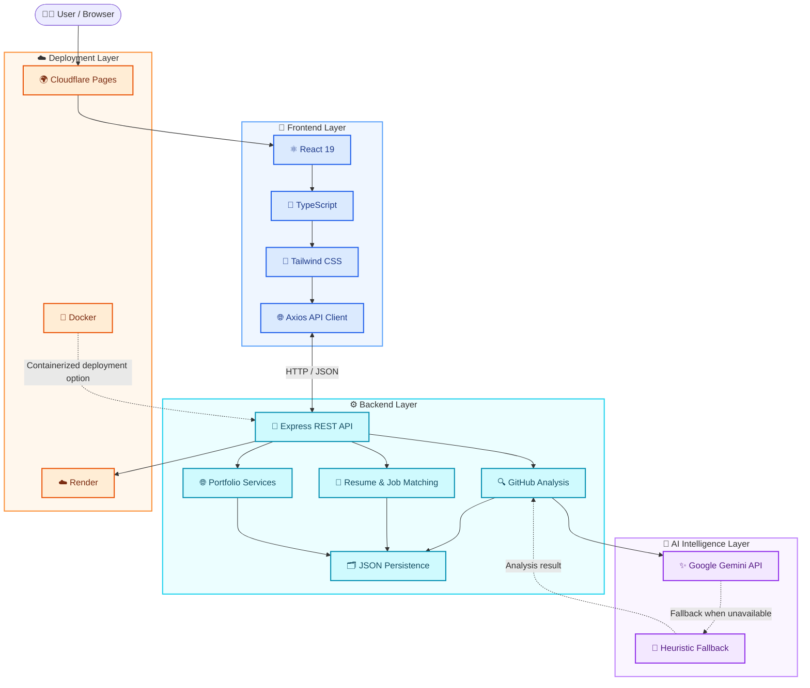

---

## 🌟 Project Vision

ProfileForge AI aims to simplify the developer career-building process by bringing GitHub intelligence, AI-assisted resume creation, job matching, personalized skill development, and portfolio presentation into one integrated platform.

**Built for developers who want to turn their code, skills, and projects into a stronger professional profile.**

<p align="center">
  <b>⚡ Analyze • Optimize • Build • Grow ⚡</b>
</p>
---

# 🔍 6. GitHub Intelligence & Repository Analyzer

ProfileForge AI analyzes developer profile information and repository metadata to generate insights into contribution activity, technology usage, and codebase quality.

The GitHub Intelligence Engine combines multiple analysis workflows to build a structured overview of a developer's technical profile.

## 🧠 GitHub Analysis Workflow

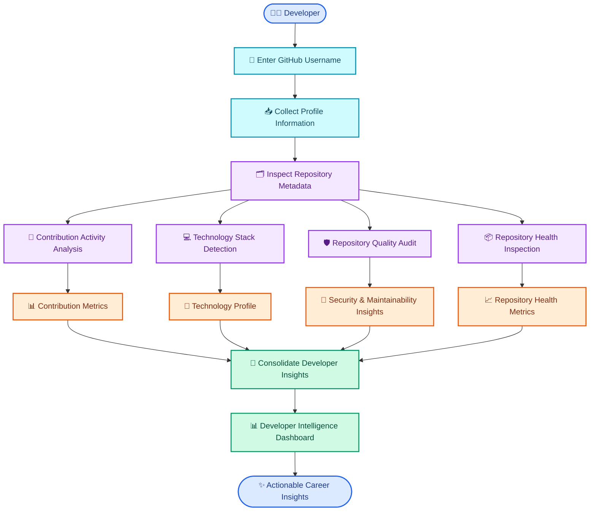

## 📅 6.1 Contribution Heatmap & Activity Analysis

The contribution analysis workflow uses a Cheerio-powered HTML calendar parser to extract contribution activity from GitHub's contribution graph.

The project is designed to analyze a 53-week contribution heatmap and derive metrics such as yearly contribution totals, longest streaks, and current active streaks.

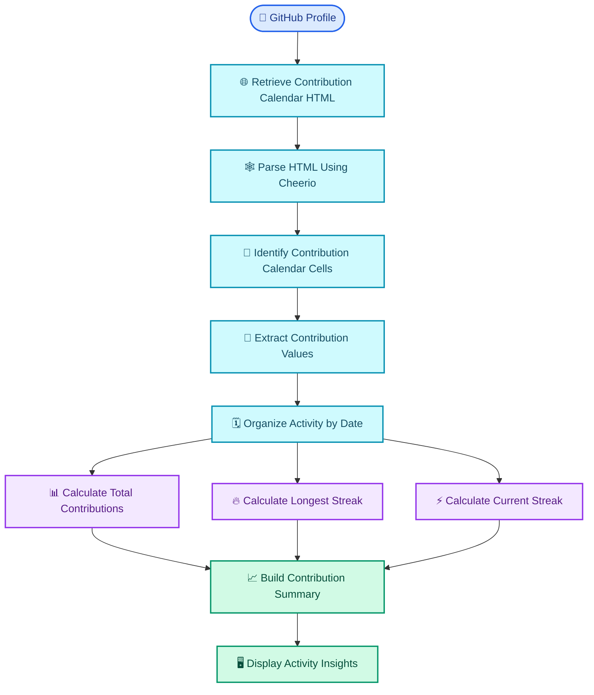

### 📊 Contribution Metrics

| Metric | Purpose |
|---|---|
| 📅 Yearly Contributions | Summarizes contribution activity across the analyzed year |
| 🔥 Longest Streak | Identifies the longest consecutive activity streak |
| ⚡ Current Streak | Represents the current active contribution streak |
| 🗓️ Activity Calendar | Organizes contribution information by date |
| 📈 Activity Summary | Provides a consolidated view of contribution patterns |

> **Implementation note:** Contribution values depend on the HTML data successfully retrieved and parsed. The workflow describes the intended analysis and does not imply that GitHub's API rate limits are universally bypassed.

---

## 💻 6.2 Polyglot Technology Stack Detection

ProfileForge AI inspects repository titles, descriptions, and metadata against technology definitions to identify a developer's potential technology stack.

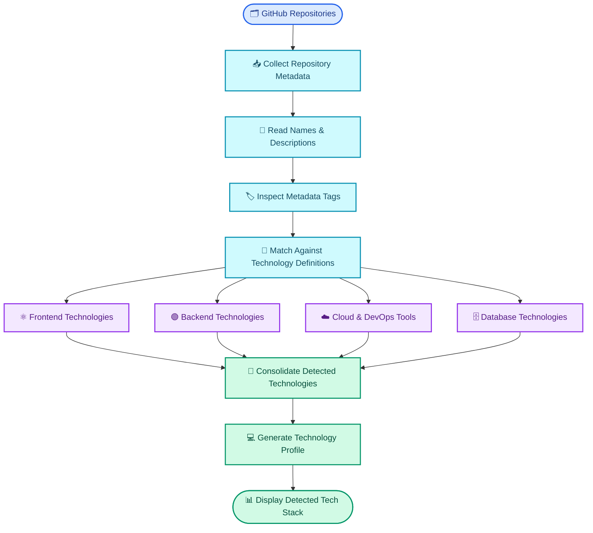

### 🧰 Example Technology Categories

| Category | Example Technologies |
|---|---|
| 🎨 Frontend | React, HTML, CSS |
| ⚙️ Backend | Node.js, Express, Go, Rust |
| ☁️ Cloud & DevOps | Docker, Kubernetes, Terraform, AWS |
| 🗄️ Databases | MongoDB |
| 🔌 API & Data | GraphQL |

*The examples above represent technology definitions described for the project; detection depends on the available repository metadata and configured matching rules.*

---

## 🛡️ 6.3 Repository Quality & Health Audit

The repository audit evaluates codebase health using multiple dimensions, helping developers identify areas that may need improvement.

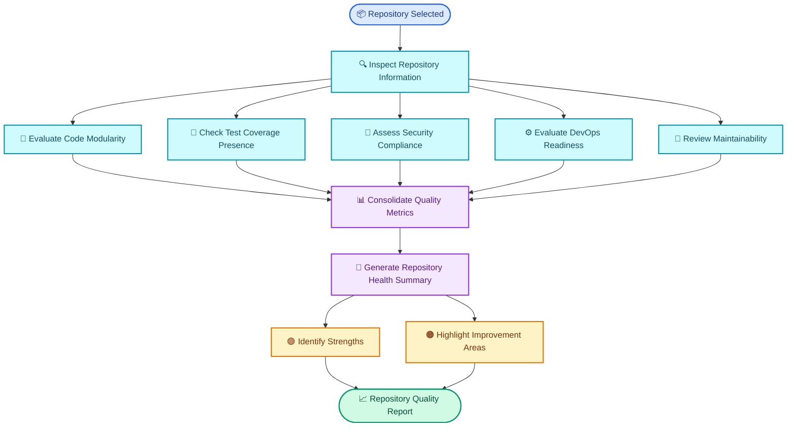

### 🔎 Audit Dimensions

- 🧱 **Code Modularity:** Evaluates available indicators of code organization and modular structure.
- 🧪 **Testing:** Checks for the presence of test coverage indicators.
- 🔐 **Security:** Assesses configured security-related indicators.
- ⚙️ **DevOps Readiness:** Reviews available indicators of deployment and infrastructure readiness.
- 🔧 **Maintainability:** Evaluates configured indicators related to codebase maintainability.

**Important:** These are automated indicators, not a substitute for a complete code review, executed test suite, or professional security assessment. Exact scoring depends on the implemented audit rules.

---

## 📊 6.4 From Raw GitHub Data to Developer Insights

This final workflow shows how the analysis outputs come together inside the developer dashboard.

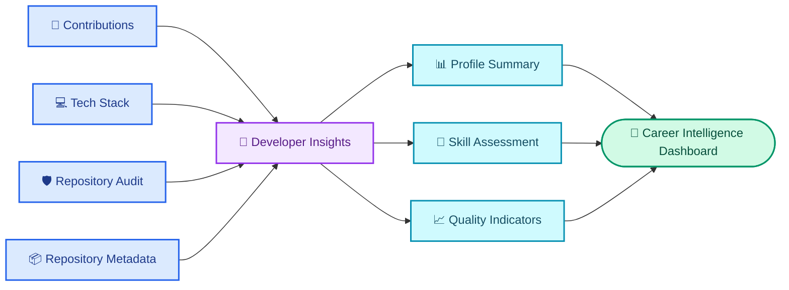

---

## 🎯 Why GitHub Intelligence Matters

A GitHub profile contains more than repository links. It can reveal contribution activity, technologies explored, project organization, and potential areas for technical growth.

ProfileForge AI brings these signals together to help developers:

- Understand their technical profile.
- Review repository health indicators.
- Identify technologies represented in their projects.
- Discover opportunities to improve code quality.
- Prepare for the next steps in resume building and job matching.

**Next:** AI Resume Builder, ATS compatibility analysis, job-description matching, and personalized skill-gap roadmaps.
---

# 📄 7. AI-Powered Resume Builder

ProfileForge AI helps developers transform their profile information, technical skills, and project details into structured, professional resume content. The resume workflow combines developer data, AI-assisted content generation, and editable resume output.

## 🧠 7.1 Resume Generation Workflow

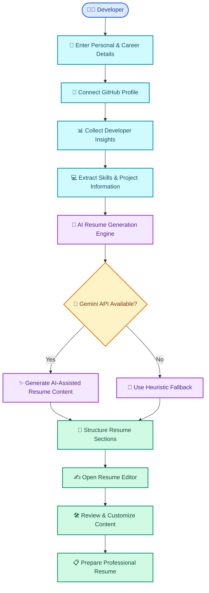

### ✨ Resume Builder Capabilities

- 📝 Generate structured resume content from developer information.
- 💻 Highlight technical skills and project experience.
- 🎯 Create action-oriented project descriptions.
- ✍️ Edit and customize resume content in the browser.
- 🧠 Use Gemini-powered generation with a heuristic fallback engine.
- 📄 Prepare professional content for career applications.

---

# 🎯 8. ATS Compatibility & Job Description Matching

The Job Description Matcher helps developers compare their resume information with a target job description. It identifies matching skills, highlights missing keywords, and provides a foundation for personalized learning recommendations.

## 🔄 8.1 ATS Matching Workflow

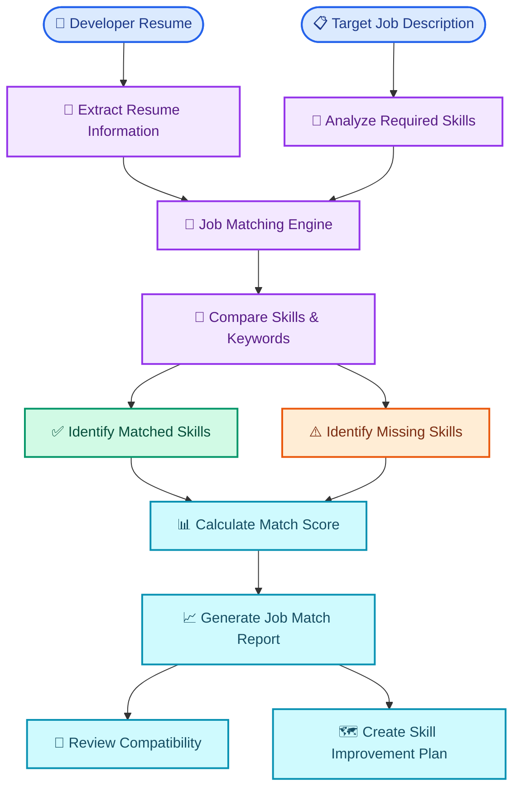

## 📊 8.2 Understanding the Job Match Report

The matching workflow produces a report containing a match score, matched skills, missing skills, and learning recommendations.

| Report Component | Purpose |
|---|---|
| 🎯 Match Score | Indicates the calculated compatibility score |
| ✅ Matched Skills | Lists skills identified in both the resume and job requirements |
| ⚠️ Missing Skills | Highlights skills identified in the job description but not in the resume |
| 🗺️ Learning Roadmap | Recommends actions to improve relevant technical skills |
| 📋 Job Match Report | Consolidates matching results into one view |

> **Important:** An ATS match score is an estimate produced by the application's matching logic. It is not an official score from an employer's applicant tracking system and does not guarantee selection.

---

# 🧩 9. Skill Gap Analysis & Personalized Learning Roadmap

ProfileForge AI connects job matching with actionable learning recommendations. Instead of only showing missing skills, the workflow helps organize them into a focused improvement plan.

## 🗺️ 9.1 Skill Gap Analysis Workflow

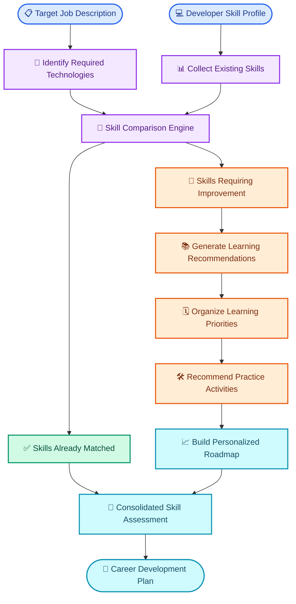

### 🎓 Roadmap Components

- 🔍 **Skill Identification:** Discover technologies requested by the target role.
- ✅ **Skill Comparison:** Separate identified strengths from missing requirements.
- 📚 **Learning Recommendations:** Suggest technical topics for improvement.
- 🛠️ **Practice Activities:** Turn learning recommendations into practical exercises.
- 📈 **Career Progression:** Use the resulting roadmap to guide continued preparation.

---

# 🔗 10. Integrated Resume-to-Job Workflow

The following diagram connects the resume builder, job matching engine, and learning roadmap into one career optimization pipeline.

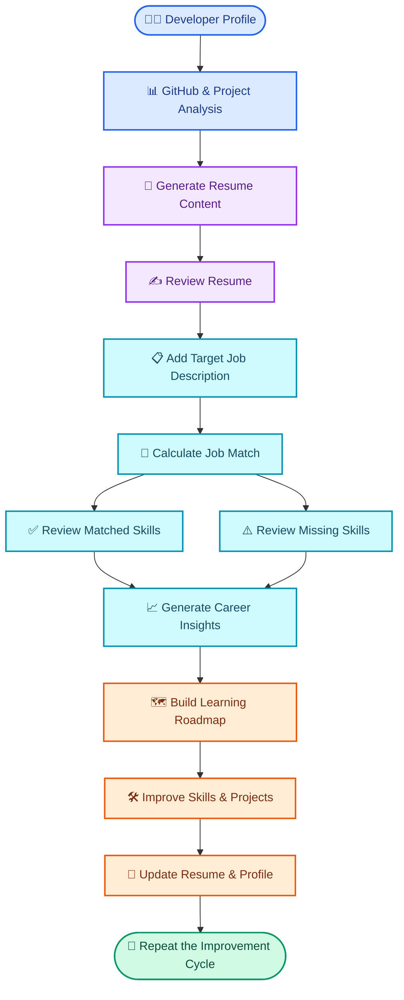

---

# 🧠 11. AI Intelligence & Fallback Architecture

The application is designed with two analysis paths: Google Gemini for AI-assisted generation and a deterministic heuristic engine as a fallback when the Gemini API is unavailable or encounters network timeouts.

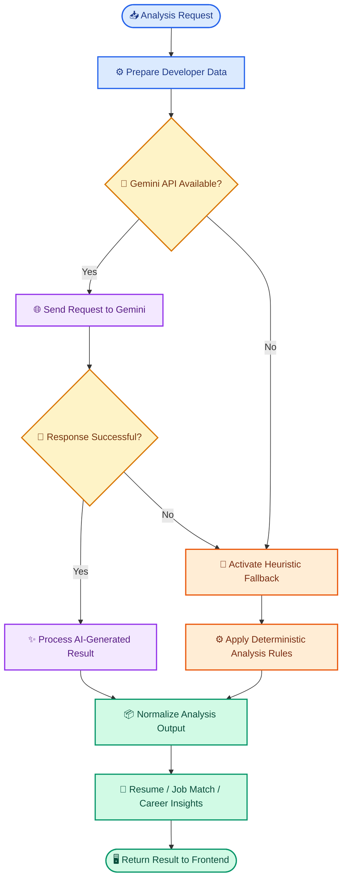

### 🤖 Why a Fallback Engine?

- 🔄 **Resilience:** Provides an alternative analysis path when Gemini is unavailable.
- ⚙️ **Deterministic Processing:** Uses predefined rules for supported analysis operations.
- 🧩 **Consistent Output Structure:** Allows fallback results to enter the same downstream processing workflow.
- 🌐 **Reduced Dependency:** Keeps supported heuristic features usable without a successful Gemini response.

*The fallback engine does not necessarily reproduce the reasoning or generative quality of Gemini. Its capabilities depend on the implemented rules.*

---

## 🌟 Career Intelligence in One Platform

ProfileForge AI connects three important activities:

1. **Build:** Generate and refine professional resume content.
2. **Match:** Compare skills with the requirements of a target job.
3. **Improve:** Turn identified gaps into a personalized learning roadmap.

This integrated workflow helps developers approach job preparation with clearer priorities and a more structured understanding of their technical profile.

**Next:** Public Portfolio Generator, Interactive Portfolio Preview, and Deployment Simulator.

---

# 🌐 12. Public Developer Portfolio Generator

ProfileForge AI includes a public portfolio generation workflow that transforms developer profile information into a shareable, theme-based portfolio page.

Developers can preview portfolio layouts, customize their presentation, and access public portfolio pages through username-based routes.

## 🎨 12.1 Portfolio Generation Workflow

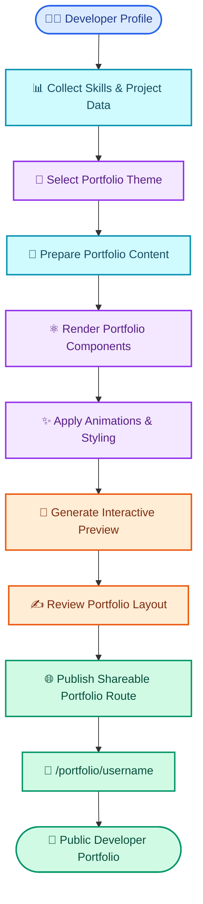

### ✨ Portfolio Features

- 🌐 **Public Portfolio Routes:** Access shareable pages through username-based URLs.
- 🎨 **Customizable Themes:** Present developer information using different portfolio themes.
- 🖥️ **Interactive Preview:** Review portfolio layouts before using the final presentation.
- 🎬 **Motion Effects:** Use Framer Motion for animations and interface transitions.
- 📱 **Responsive Presentation:** Organize portfolio content for different screen sizes.
- 💻 **Project Showcase:** Present technical skills and project information in a professional format.

---

# 🖥️ 13. Interactive Portfolio Preview Architecture

The portfolio preview workflow connects portfolio data, theme configuration, reusable React components, and the rendered preview.

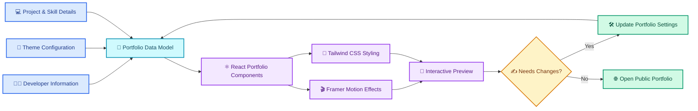

### 🧱 Portfolio UI Components

| Component | Responsibility |
|---|---|
| `LivePreview.tsx` | Displays an interactive portfolio preview |
| `PremiumPortfolio.tsx` | Provides a premium-style animated portfolio layout |
| `PublicPortfolio.tsx` | Renders a shareable public portfolio page |
| `LogoIcon.tsx` | Provides the custom application brand mark |
| `LandingPage.tsx` | Provides the landing page and profile analyzer entry point |

---

# 🚀 14. Deployment Simulator

ProfileForge AI includes a deployment simulation workflow designed to demonstrate the stages of a frontend portfolio deployment, including repository preparation, dependency installation, build compilation, SSL provisioning, and edge-routing stages.

**Important:** This feature simulates a deployment process. Its generated logs should not be interpreted as proof that an actual Vercel deployment has occurred.

## ⚙️ 14.1 Deployment Simulation Flow

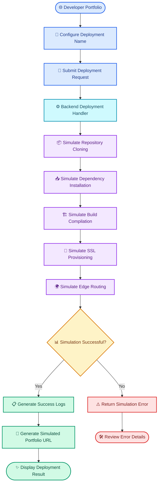

## 📟 14.2 Simulated Deployment Log Lifecycle

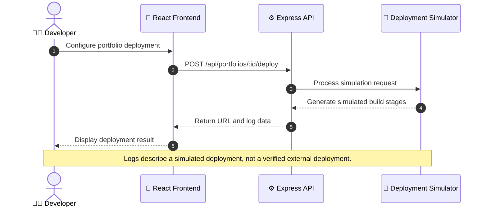

### 📋 Example Simulated Stages

| Stage | Example Activity |
|---|---|
| 1. 📦 Repository Preparation | Simulated repository cloning |
| 2. 📥 Dependency Installation | Simulated package installation |
| 3. 🏗️ Build Compilation | Simulated bundle compilation |
| 4. 🔐 SSL Provisioning | Simulated SSL setup |
| 5. 🌍 Edge Routing | Simulated edge-routing configuration |
| 6. 🎉 Result | Display generated URL and simulation logs |

---

# 🔗 15. Public Portfolio Routing

The frontend uses React Router DOM to handle application navigation and username-based public portfolio routes.

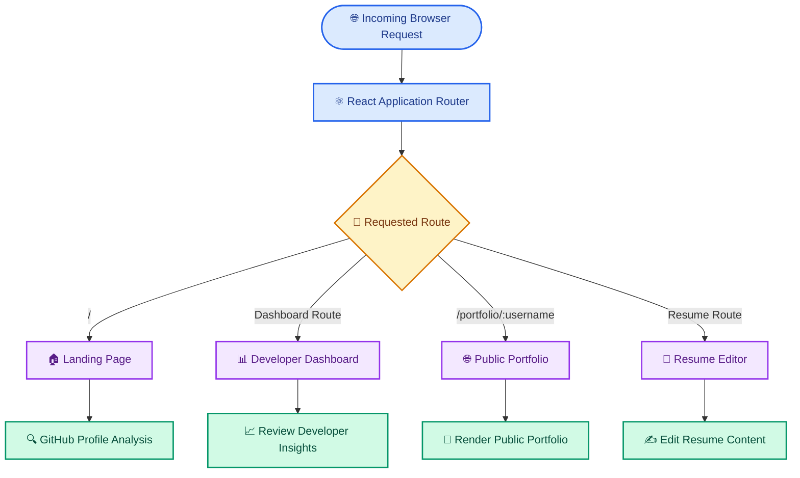

*The diagram represents the main route categories and public portfolio route pattern. Exact route paths should be aligned with the application's current router configuration.*

---

# ☁️ 16. Portfolio Hosting & Application Deployment

The project separates frontend hosting from backend hosting. Cloudflare Pages serves the frontend, while Render hosts the Express API.

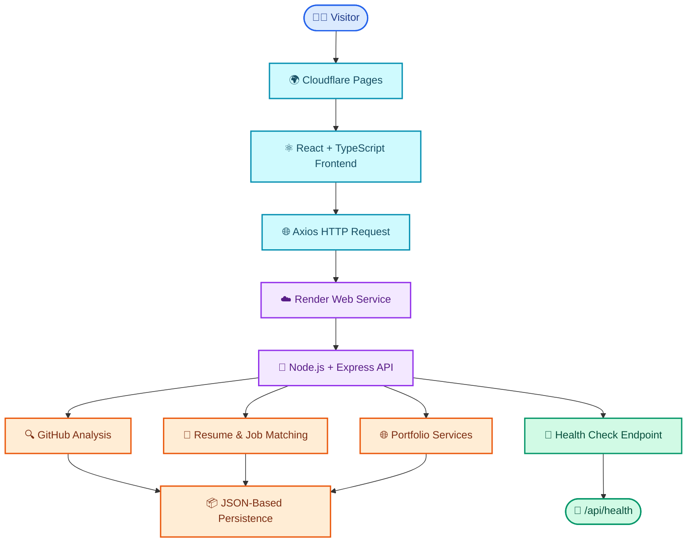

### 🌍 Deployment Endpoints

| Component | Platform | URL |
|---|---|---|
| Frontend | Cloudflare Pages | [profileforge1.pages.dev](https://profileforge1.pages.dev) |
| Backend API | Render | [profileforge-ye6a.onrender.com](https://profileforge-ye6a.onrender.com) |
| Health Check | Render | [API Health Endpoint](https://profileforge-ye6a.onrender.com/api/health) |

---

## 🎯 Why PortfolioForge Workflows Matter

These workflows illustrate how ProfileForge AI brings developer presentation, interactive previews, and deployment education into a single experience.

- 🌐 Build a shareable developer portfolio.
- 🎨 Preview and refine a portfolio layout.
- 🚀 Understand the stages of a deployment workflow.
- 🧩 Connect the frontend to backend portfolio services.
- ☁️ Separate frontend and API hosting responsibilities.

**Next:** Backend Architecture, REST API Reference, Request/Response Examples, and Data Flow Diagrams.
---

# ⚙️ 17. Backend Architecture

ProfileForge AI uses Node.js and Express to provide REST API endpoints for GitHub analysis, resume generation, job matching, portfolio management, and deployment simulation.

The backend connects frontend requests with analysis logic, AI-assisted generation, and JSON-based persistence.

## 🏗️ 17.1 Backend System Architecture

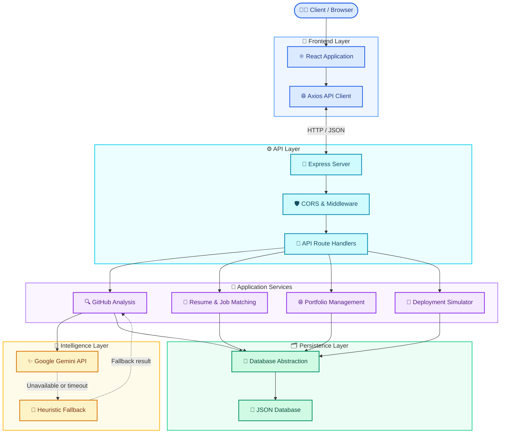

### 🧩 Main Backend Responsibilities

| Component | Responsibility |
|---|---|
| `server.js` | Express server initialization and middleware configuration |
| `routes/analyze.js` | GitHub analysis and AI-assisted synthesis |
| `routes/auth.js` | User session and profile management |
| `routes/portfolios.js` | Portfolio operations and deployment simulation |
| `routes/resumes.js` | Resume operations and job-description matching |
| `db.js` | Database abstraction and persistence operations |
| `data/db.json` | JSON-based application data storage |

---

# 📡 18. REST API Reference

The following endpoints are documented in the project.

| Method | Endpoint | Purpose |
|---|---|---|
| `GET` | `/api/health` | Check API health |
| `POST` | `/api/analyze` | Analyze a GitHub profile and generate developer insights |
| `POST` | `/api/resumes/:id/match-job` | Compare resume information with a job description |
| `POST` | `/api/portfolios/:id/deploy` | Run the portfolio deployment simulation |

---

## 💚 18.1 API Health Check

The health endpoint provides a simple response indicating that the API is responding.

**Endpoint**

```http
GET /api/health
```

**Example response**

```json
{
  "status": "ok",
  "time": "2026-10-11T08:00:00.000Z"
}
```

### Health Check Flow

```mermaid
sequenceDiagram
    autonumber
    actor User as 👨‍💻 Client
    participant API as 🚂 Express API
    participant Health as 💚 Health Handler

    User->>API: GET /api/health
    API->>Health: Process health request
    Health-->>API: Return status and timestamp
    API-->>User: HTTP 200 OK + JSON

    Note over User,Health: Confirms endpoint responsiveness, not every dependency's health.
```

---

# 🔍 19. GitHub Profile Analysis API

The profile analysis endpoint accepts developer details and initiates the analysis workflow.

## 📥 Request

```http
POST /api/analyze
Content-Type: application/json
```

**Example request body**

```json
{
  "githubUsername": "your-github-username",
  "fullName": "Your Name",
  "email": "you@example.com",
  "phone": "+91-XXXXXXXXXX",
  "linkedinUrl": "https://linkedin.com/in/your-profile",
  "theme": "modern"
}
```

Replace the example values with your own information. Avoid including personal information in public examples.

## 🔄 19.1 Analysis Request Lifecycle

```mermaid
sequenceDiagram
    autonumber
    actor User as 👨‍💻 Developer
    participant UI as ⚛️ React Frontend
    participant API as 🚂 Express API
    participant Analyzer as 🔍 Analysis Engine
    participant AI as 🤖 AI / Fallback
    participant DB as 🗂️ JSON Persistence

    User->>UI: Submit GitHub profile
    UI->>API: POST /api/analyze
    API->>Analyzer: Process profile information
    Analyzer->>AI: Request career analysis
    AI-->>Analyzer: Return supported analysis result
    Analyzer->>DB: Perform required persistence operations
    DB-->>Analyzer: Return persistence result
    Analyzer-->>API: Return analysis output
    API-->>UI: JSON response
    UI-->>User: Display developer insights

    Note over Analyzer,AI: The exact call sequence depends on the implemented route and service logic.
```

---

# 🎯 20. Job Description Matching API

This endpoint compares resume information with a target job description and returns matching results.

## 📥 Request

```http
POST /api/resumes/:id/match-job
Content-Type: application/json
```

**Example request body**

```json
{
  "jobDescription": "Looking for a Full Stack Engineer with React, Node.js, Kubernetes, and Redis experience."
}
```

## 📤 Example Response

```json
{
  "success": true,
  "matchScore": 85,
  "matchedSkills": [
    "React",
    "Node.js"
  ],
  "missingSkills": [
    "Kubernetes",
    "Redis"
  ],
  "learningRoadmap": [
    "Learn Kubernetes fundamentals and deployment workflows.",
    "Practice Redis caching and session management."
  ]
}
```

*This is an illustrative example of the documented response structure, not a live result.*

## 🧠 20.1 Job Matching Sequence Diagram

```mermaid
sequenceDiagram
    autonumber
    actor User as 👨‍💻 Developer
    participant UI as 🎨 Frontend
    participant API as 🚂 Express API
    participant Match as 🎯 Matching Engine
    participant Store as 🗂️ Persistence

    User->>UI: Enter job description
    UI->>API: POST /api/resumes/:id/match-job
    API->>Match: Process resume and job requirements
    Match->>Match: Identify matched and missing skills
    Match->>Match: Calculate compatibility score
    Match->>Match: Prepare learning recommendations
    Match->>Store: Perform required data operations
    Store-->>Match: Return operation result
    Match-->>API: Return job match report
    API-->>UI: JSON response
    UI-->>User: Display score and skill gaps
```

### 📊 Response Fields

| Field | Description |
|---|---|
| `success` | Indicates the reported operation status |
| `matchScore` | Calculated compatibility score |
| `matchedSkills` | Skills identified as matching |
| `missingSkills` | Skills identified as missing |
| `learningRoadmap` | Learning recommendations |

---

# 🚀 21. Portfolio Deployment Simulation API

The deployment endpoint accepts a portfolio identifier and a requested deployment name, then returns the simulation result.

## 📥 Request

```http
POST /api/portfolios/:id/deploy
Content-Type: application/json
```

**Example request body**

```json
{
  "vercelSubdomain": "my-developer-portfolio"
}
```

## 📤 Example Response

```json
{
  "success": true,
  "deployedUrl": "https://my-developer-portfolio.vercel.app",
  "logs": [
    "[10:14:02] Repository cloning simulation...",
    "[10:14:08] Dependency installation simulation...",
    "[10:14:14] Build compilation simulation...",
    "[10:14:20] Deployment simulation completed."
  ]
}
```

*The response illustrates the documented payload shape. The URL and log messages do not independently verify a real Vercel deployment.*

## 🔄 21.1 Deployment Request Lifecycle

```mermaid
sequenceDiagram
    autonumber
    actor User as 👨‍💻 Developer
    participant UI as ⚛️ Frontend
    participant API as 🚂 Express API
    participant Deploy as 🚀 Simulation Handler

    User->>UI: Configure portfolio name
    UI->>API: POST /api/portfolios/:id/deploy
    API->>Deploy: Process deployment request
    Deploy->>Deploy: Prepare simulated build stages
    Deploy->>Deploy: Generate result and log data
    Deploy-->>API: Return simulation response
    API-->>UI: JSON result
    UI-->>User: Display logs and generated URL

    Note over API,Deploy: This workflow represents the application's simulator, not an actual external deployment.
```

---

# 🗂️ 22. Data Persistence Architecture

The project uses `fs-extra` and a JSON file as its lightweight persistence mechanism, with `db.js` providing a database abstraction layer.

```mermaid
flowchart TD
    A(["📥 Incoming API Request"]) --> B["🚂 Express Route Handler"]
    B --> C["⚙️ Application Logic"]
    C --> D["🔧 db.js Abstraction Layer"]

    D --> E{"🗂️ Required Operation"}

    E -->|Read| F["📖 Read JSON Data"]
    E -->|Create or Update| G["✍️ Write JSON Data"]
    E -->|Delete| H["🗑️ Remove Stored Record"]

    F --> I["📦 Prepare Result"]
    G --> I
    H --> I

    I --> J["📤 Return Application Response"]
    J --> K(["🌐 Client"])

    classDef request fill:#DBEAFE,stroke:#2563EB,color:#1E3A8A,stroke-width:2px
    classDef process fill:#CFFAFE,stroke:#0891B2,color:#164E63,stroke-width:2px
    classDef storage fill:#F3E8FF,stroke:#9333EA,color:#581C87,stroke-width:2px
    classDef result fill:#D1FAE5,stroke:#059669,color:#064E3B,stroke-width:2px

    class A,B request
    class C,D,E process
    class F,G,H storage
    class I,J,K result
```

### 📝 Persistence Notes

- 🗂️ Application data is stored in a JSON file.
- 🔧 `db.js` abstracts supported persistence operations.
- 📁 The data file is located under `backend/data/`.
- ⚠️ JSON-file persistence has scalability and concurrent-write limitations compared with a production database.
- 💾 Persistent storage configuration should be verified for the selected deployment environment.

---

# 🔐 23. API Security & Error Handling Considerations

The project configures CORS and request middleware. The following practices are important when preparing the API for production.

```mermaid
flowchart TD
    A(["🌐 Incoming API Request"]) --> B["🛡️ Apply Configured Middleware"]
    B --> C["🔎 Validate Request Data"]
    C --> D{"✅ Request Valid?"}

    D -->|Yes| E["⚙️ Execute Route Logic"]
    D -->|No| F["⚠️ Return Validation Error"]

    E --> G{"📡 Operation Successful?"}
    G -->|Yes| H["📤 Return JSON Response"]
    G -->|No| I["🧯 Handle Application Error"]

    I --> J["📋 Return Appropriate Error Response"]
    F --> K(["🌐 Client Receives Response"])
    H --> K
    J --> K

    classDef request fill:#DBEAFE,stroke:#2563EB,color:#1E3A8A,stroke-width:2px
    classDef middleware fill:#CFFAFE,stroke:#0891B2,color:#164E63,stroke-width:2px
    classDef decision fill:#FEF3C7,stroke:#D97706,color:#78350F,stroke-width:2px
    classDef success fill:#D1FAE5,stroke:#059669,color:#064E3B,stroke-width:2px
    classDef error fill:#FEE2E2,stroke:#DC2626,color:#7F1D1D,stroke-width:2px

    class A request
    class B,C middleware
    class D,G decision
    class E,H success
    class F,I,J error
    class K request
```

### 🛡️ Recommended Production Checks

- Validate request bodies and route parameters.
- Restrict CORS to trusted origins where appropriate.
- Avoid exposing API keys or sensitive environment variables.
- Use safe error responses without leaking internal details.
- Apply rate limiting and request-size limits where appropriate.
- Review authentication and authorization before exposing sensitive operations.
- Use persistent storage suitable for the expected traffic and data requirements.

These are production recommendations; they should not be interpreted as confirmation that every control is already implemented.

---

## 🎯 Backend Summary

ProfileForge AI's backend connects profile analysis, AI-assisted resume generation, job matching, portfolio services, and deployment simulation through a REST API.

The architecture combines Express route handlers, application services, Gemini integration with a heuristic fallback, and JSON-based persistence.

**Next:** Repository Folder Structure, Docker & Docker Compose Architecture, CI/CD Workflow, and Production Deployment Guide.

---

# 🐳 24. Docker & Containerization

ProfileForge AI includes Docker configurations for packaging the frontend and backend into containers. Docker Compose provides a convenient way to configure and run the application services together.

Containerization helps standardize application environments and simplifies local development and deployment workflows.

## 🏗️ 24.1 Containerization Architecture

```mermaid
flowchart TB
    A(["👨‍💻 Developer"]) --> B["📂 ProfileForge AI Repository"]

    B --> C["🐳 Frontend Dockerfile"]
    B --> D["🐳 Backend Dockerfile"]

    C --> E["⚡ Build Frontend Assets"]
    E --> F["🌐 Nginx Alpine Container"]

    D --> G["📦 Node.js Dependencies"]
    G --> H["🚂 Express API Container"]

    F --> I["🎨 Frontend Service"]
    H --> J["⚙️ Backend Service"]

    I <-->|"HTTP / API Requests"| J

    I --> K(["🚀 Containerized Application"])
    J --> K

    classDef source fill:#DBEAFE,stroke:#2563EB,color:#1E3A8A,stroke-width:2px
    classDef docker fill:#CFFAFE,stroke:#0891B2,color:#164E63,stroke-width:2px
    classDef frontend fill:#D1FAE5,stroke:#059669,color:#064E3B,stroke-width:2px
    classDef backend fill:#F3E8FF,stroke:#9333EA,color:#581C87,stroke-width:2px
    classDef output fill:#FEF3C7,stroke:#D97706,color:#78350F,stroke-width:2px

    class A,B source
    class C,D,E,G docker
    class F,I frontend
    class H,J backend
    class K output
```

### 🧱 Container Responsibilities

| Component | Responsibility |
|---|---|
| `frontend/Dockerfile` | Builds the frontend and packages the production assets |
| Nginx Alpine | Serves the built frontend assets |
| `backend/Dockerfile` | Packages the Node.js backend |
| Express API | Processes backend application requests |
| Docker Compose | Coordinates configured services |

---

# 📦 25. Docker Compose Architecture

Docker Compose allows the frontend and backend to be configured as services in one Compose project.

```mermaid
flowchart TD
    A(["📄 docker-compose.yml"]) --> B["⚙️ Compose Service Configuration"]

    B --> C["🌐 Frontend Service"]
    B --> D["🚂 Backend Service"]

    C --> E["🐳 Nginx Container"]
    D --> F["🐳 Node.js Container"]

    E --> G["🖥️ Serve Frontend"]
    F --> H["📡 Handle API Requests"]

    G <-->|"Frontend to Backend API Traffic"| H

    I["🔌 Published Host Ports"] --> E
    I --> F

    G --> J(["🚀 Running Application"])
    H --> J

    classDef compose fill:#DBEAFE,stroke:#2563EB,color:#1E3A8A,stroke-width:2px
    classDef service fill:#CFFAFE,stroke:#0891B2,color:#164E63,stroke-width:2px
    classDef container fill:#F3E8FF,stroke:#9333EA,color:#581C87,stroke-width:2px
    classDef running fill:#D1FAE5,stroke:#059669,color:#064E3B,stroke-width:2px

    class A,B compose
    class C,D service
    class E,F,G,H,I container
    class J running
```

## 🛠️ 25.1 Docker Compose Commands

Build and start the configured services:

```bash
docker compose up --build -d
```

Check the running services:

```bash
docker compose ps
```

View application logs:

```bash
docker compose logs -f
```

View logs for an individual service:

```bash
docker compose logs -f frontend
docker compose logs -f backend
```

Stop and remove the Compose containers:

```bash
docker compose down
```

Rebuild the application after changing the source or Docker configuration:

```bash
docker compose up --build -d
```

### 🔄 Container Lifecycle

```mermaid
flowchart LR
    A["📝 Source Code"] --> B["🏗️ docker compose build"]
    B --> C["📦 Container Images"]
    C --> D["🚀 docker compose up"]
    D --> E["🟢 Running Services"]
    E --> F["📋 Inspect Logs & Status"]
    F --> G["🛑 docker compose down"]

    classDef source fill:#DBEAFE,stroke:#2563EB,color:#1E3A8A,stroke-width:2px
    classDef build fill:#CFFAFE,stroke:#0891B2,color:#164E63,stroke-width:2px
    classDef runtime fill:#D1FAE5,stroke:#059669,color:#064E3B,stroke-width:2px
    classDef stop fill:#FEE2E2,stroke:#DC2626,color:#7F1D1D,stroke-width:2px

    class A source
    class B,C build
    class D,E,F runtime
    class G stop
```

---

# 🔄 26. CI/CD & GitHub Actions

GitHub Actions can automate repeatable checks and build tasks when code is pushed to the repository or a pull request is opened.

The workflow below represents a recommended CI/CD pipeline for ProfileForge AI. The exact triggers and jobs depend on the repository's actual workflow configuration.

## 🚀 26.1 CI/CD Pipeline Architecture

```mermaid
flowchart TD
    A(["👨‍💻 Developer"]) --> B["📤 Push Code to GitHub"]
    B --> C["🔔 GitHub Actions Trigger"]

    C --> D["📥 Checkout Repository"]
    D --> E["🟢 Set Up Node.js"]
    E --> F["📦 Install Dependencies"]

    F --> G["🧪 Run Configured Tests"]
    G --> H{"✅ Checks Passed?"}

    H -->|No| I["❌ Mark Workflow Failed"]
    H -->|Yes| J["🏗️ Build Frontend"]

    J --> K{"📦 Build Successful?"}
    K -->|No| I
    K -->|Yes| L["📋 Complete CI Checks"]

    L --> M["🌍 Deployment Workflow"]
    M --> N(["🚀 Updated Application"])

    classDef source fill:#DBEAFE,stroke:#2563EB,color:#1E3A8A,stroke-width:2px
    classDef pipeline fill:#CFFAFE,stroke:#0891B2,color:#164E63,stroke-width:2px
    classDef decision fill:#FEF3C7,stroke:#D97706,color:#78350F,stroke-width:2px
    classDef success fill:#D1FAE5,stroke:#059669,color:#064E3B,stroke-width:2px
    classDef failure fill:#FEE2E2,stroke:#DC2626,color:#7F1D1D,stroke-width:2px

    class A,B source
    class C,D,E,F,G,J pipeline
    class H,K decision
    class L,M,N success
    class I failure
```

### 🧪 Suggested CI Checks

- 📦 Install frontend and backend dependencies.
- 🧹 Run configured linting checks, if available.
- 🧪 Execute automated tests, if available.
- 🏗️ Verify that the frontend production build succeeds.
- 🐳 Build Docker images as an optional pipeline stage.
- 🔐 Store deployment credentials in repository secrets rather than source code.
- 📋 Review workflow logs when a job fails.

**Important:** Do not describe tests, security scans, or automated Docker publishing as implemented unless the current GitHub Actions workflow actually performs those steps.

---

# ☁️ 27. Production Hosting Architecture

The deployed application separates frontend delivery from backend API processing.

- **Cloudflare Pages:** Hosts the React frontend.
- **Render:** Hosts the Node.js and Express backend.
- **Axios:** Connects the frontend to the backend API.
- **Health endpoint:** Provides a simple API responsiveness check.

## 🌐 27.1 Frontend & Backend Deployment Flow

```mermaid
flowchart TB
    A(["👨‍💻 Developer"]) --> B["📤 Push Changes to GitHub"]

    B --> C["🌍 Cloudflare Pages"]
    B --> D["☁️ Render Web Service"]

    C --> E["🏗️ Build React + TypeScript"]
    E --> F["📦 Publish Frontend Assets"]

    D --> G["📦 Install Backend Dependencies"]
    G --> H["🚂 Start Express Server"]

    F --> I(["🌐 Live Frontend"])
    H --> J(["📡 Live Backend API"])

    I <-->|"HTTPS / JSON Requests"| J

    J --> K["💚 API Health Endpoint"]

    classDef developer fill:#DBEAFE,stroke:#2563EB,color:#1E3A8A,stroke-width:2px
    classDef cloud fill:#CFFAFE,stroke:#0891B2,color:#164E63,stroke-width:2px
    classDef frontend fill:#D1FAE5,stroke:#059669,color:#064E3B,stroke-width:2px
    classDef backend fill:#F3E8FF,stroke:#9333EA,color:#581C87,stroke-width:2px
    classDef health fill:#FEF3C7,stroke:#D97706,color:#78350F,stroke-width:2px

    class A,B developer
    class C,D cloud
    class E,F,I frontend
    class G,H,J backend
    class K health
```

## ⚙️ 27.2 Frontend Environment Configuration

For local development, the frontend can use an API base URL such as:

```env
VITE_API_URL=http://localhost:5000/api
```

For production, configure the frontend environment variable to point to the deployed API:

```env
VITE_API_URL=https://profileforge-ye6a.onrender.com/api
```

The production value should match the actual backend URL and must be configured in the frontend hosting settings before building.

### 🔐 Environment Variable Flow

```mermaid
flowchart LR
    A["🛠️ Environment Configuration"] --> B["⚛️ Frontend Build"]
    A --> C["🚂 Backend Runtime"]

    B --> D["🌐 VITE_API_URL"]
    C --> E["🔐 Server Environment Variables"]

    D --> F["📡 Frontend API Requests"]
    E --> G["🤖 Optional API Credentials"]

    F --> H(["🔗 Connected Application"])
    G --> H

    classDef config fill:#DBEAFE,stroke:#2563EB,color:#1E3A8A,stroke-width:2px
    classDef frontend fill:#CFFAFE,stroke:#0891B2,color:#164E63,stroke-width:2px
    classDef backend fill:#F3E8FF,stroke:#9333EA,color:#581C87,stroke-width:2px
    classDef output fill:#D1FAE5,stroke:#059669,color:#064E3B,stroke-width:2px

    class A config
    class B,D,F frontend
    class C,E,G backend
    class H output
```

> **Security note:** Variables prefixed with `VITE_` are exposed to the frontend bundle. Never place private API keys or backend secrets in them.

---

# 🩺 28. Application Health & Troubleshooting

A deployment is useful only when the frontend can communicate with the backend and the API responds as expected.

Use the health endpoint to check whether the backend is responding:

```text
https://profileforge-ye6a.onrender.com/api/health
```

## 🔍 Troubleshooting Workflow

```mermaid
flowchart TD
    A(["⚠️ Application Issue"]) --> B{"🌐 Frontend Loads?"}

    B -->|No| C["🔎 Inspect Frontend Build & Hosting Logs"]
    B -->|Yes| D{"📡 API Responds?"}

    D -->|No| E["🔎 Inspect Render Logs & Server Status"]
    D -->|Yes| F{"🔗 API Requests Succeed?"}

    F -->|No| G["🛠️ Check API URL, CORS & Request Payload"]
    F -->|Yes| H["🔍 Inspect Feature-Specific Logic"]

    C --> I["🔄 Apply Fix & Redeploy"]
    E --> I
    G --> I
    H --> I

    I --> J(["✅ Recheck Application"])

    classDef issue fill:#FEE2E2,stroke:#DC2626,color:#7F1D1D,stroke-width:2px
    classDef decision fill:#FEF3C7,stroke:#D97706,color:#78350F,stroke-width:2px
    classDef inspect fill:#CFFAFE,stroke:#0891B2,color:#164E63,stroke-width:2px
    classDef success fill:#D1FAE5,stroke:#059669,color:#064E3B,stroke-width:2px

    class A issue
    class B,D,F decision
    class C,E,G,H,I inspect
    class J success
```

### 🧰 Common Checks

| Symptom | What to Check |
|---|---|
| Frontend build fails | Build logs, dependency versions, and build command |
| API connection fails | `VITE_API_URL`, backend status, and network requests |
| CORS error | Configured allowed origins and API request origin |
| API returns an error | Response status, server logs, and request payload |
| Environment variable missing | Hosting environment settings and rebuild requirements |
| Container fails to start | Docker logs, port configuration, and startup command |

---

# 📊 29. DevOps Practices Demonstrated

| Practice | How It Applies |
|---|---|
| 🐳 Containerization | Packages application components using Docker |
| 📦 Service Orchestration | Runs configured containers using Docker Compose |
| 🔄 CI/CD | Automates configured repository checks and build workflows |
| ☁️ Cloud Hosting | Separates frontend and backend hosting |
| 🔐 Configuration Management | Uses environment variables for environment-specific settings |
| 🩺 Health Checks | Exposes an API health endpoint |
| 📋 Troubleshooting | Uses hosting logs and request diagnostics to investigate issues |

---

## 🚀 Infrastructure Summary

ProfileForge AI combines a React frontend, Express backend, Docker-based containerization, Docker Compose orchestration, and separate frontend and backend hosting.

The architecture demonstrates how a full-stack application can be packaged, configured, deployed, and troubleshot using commonly used development and DevOps practices.

**Next:** Part 7 — Complete Folder Structure, Installation Guide, Environment Variables, Final README Sections, and GitHub Presentation Polish.

---

# 📂 30. Project Folder Structure

ProfileForge AI follows a frontend-backend project structure, separating the user interface, API routes, reusable components, and deployment configuration.

```text
ProfileForge/
│
├── 📁 backend/
│   ├── 📁 data/
│   │   └── db.json
│   │
│   ├── 📁 routes/
│   │   ├── analyze.js
│   │   ├── auth.js
│   │   ├── portfolios.js
│   │   └── resumes.js
│   │
│   ├── 🐳 Dockerfile
│   ├── db.js
│   ├── package.json
│   └── server.js
│
├── 📁 frontend/
│   ├── 📁 public/
│   │   └── favicon.svg
│   │
│   ├── 📁 src/
│   │   ├── 📁 assets/
│   │   ├── 📁 components/
│   │   │   ├── CustomChart.tsx
│   │   │   ├── Dashboard.tsx
│   │   │   ├── LandingPage.tsx
│   │   │   ├── LivePreview.tsx
│   │   │   ├── LogoIcon.tsx
│   │   │   ├── PremiumPortfolio.tsx
│   │   │   ├── PublicPortfolio.tsx
│   │   │   └── ResumeEditor.tsx
│   │   │
│   │   ├── api.ts
│   │   ├── App.tsx
│   │   ├── index.css
│   │   └── main.tsx
│   │
│   ├── 🐳 Dockerfile
│   ├── package.json
│   ├── tailwind.config.js
│   └── vite.config.ts
│
├── 📁 public/
│   ├── developerprofile.png
│   ├── airesumerbuilder.png
│   ├── repositoryanalytic.png
│   └── milestonetimeline.png
│
├── 🐳 docker-compose.yml
├── 📦 package.json
├── start-all.js
└── 📘 README.md
```

*This tree reflects the documented project structure. Additional files may exist in your repository.*

## 🧩 30.1 Component Responsibilities

| Component | Purpose |
|---|---|
| `Dashboard.tsx` | Developer dashboard and analytics |
| `LandingPage.tsx` | Landing page and profile analyzer |
| `LivePreview.tsx` | Interactive portfolio preview |
| `PremiumPortfolio.tsx` | Animated portfolio layout |
| `PublicPortfolio.tsx` | Shareable public portfolio |
| `ResumeEditor.tsx` | Browser-based resume editing |
| `CustomChart.tsx` | Visual charts and analytics |
| `api.ts` | Frontend API client and endpoint mapping |
| `server.js` | Express server configuration |
| `db.js` | JSON persistence abstraction |

---

# 🛠️ 31. Getting Started

Follow these steps to run ProfileForge AI locally.

## 📋 Prerequisites

Before installation, ensure the following tools are available:

- 🟢 Node.js 20 or later
- 📦 npm
- 🔀 Git
- 🐳 Docker Desktop (optional, for containerized execution)

Check your installed versions:

```bash
node --version
npm --version
git --version
docker --version
```

## 📥 31.1 Clone the Repository

```bash
git clone https://github.com/Mausam-Kumari9534/ProfileForge.git
cd ProfileForge
```

## 📦 31.2 Install Dependencies

Install root dependencies:

```bash
npm install
```

Install backend dependencies:

```bash
cd backend
npm install
cd ..
```

Install frontend dependencies:

```bash
cd frontend
npm install
cd ..
```

> If the root `package.json` defines an `install-all` script, you can use `npm run install-all` instead. Otherwise, install each package separately as shown above.

## 🔐 31.3 Configure Environment Variables

Create a `.env` file in the `backend/` directory:

```env
PORT=5000
NODE_ENV=development

GEMINI_API_KEY=your_gemini_api_key
GITHUB_TOKEN=your_github_token
```

The Gemini and GitHub credentials are optional according to the project's documented fallback approach, but some functionality may depend on API access or successful public-page retrieval.

For local frontend development, configure `frontend/.env`:

```env
VITE_API_URL=http://localhost:5000/api
```

### 🔒 Environment Variable Safety

- Never commit private API keys or credentials to GitHub.
- Keep backend secrets in the backend environment.
- Remember that `VITE_` variables are exposed to the frontend.
- Add `.env` files to `.gitignore`.
- Provide a safe `.env.example` containing placeholder values when needed.

## ▶️ 31.4 Start the Application

If the root package defines a `dev` script that starts both applications:

```bash
npm run dev
```

Expected local addresses, depending on the project configuration:

| Service | Local URL |
|---|---|
| Frontend | `http://localhost:5173` |
| Backend API | `http://localhost:5000` |
| Health Check | `http://localhost:5000/api/health` |

If the root script does not start both services, use the scripts configured in each package's `package.json`.

---

# 🔄 32. Local Development Workflow

```mermaid id="j4xb7z"
flowchart TD
    A(["👨‍💻 Developer"]) --> B["📥 Clone Repository"]
    B --> C["📦 Install Dependencies"]
    C --> D["🔐 Configure Environment Variables"]

    D --> E["⚛️ Start Frontend"]
    D --> F["🚂 Start Backend"]

    E --> G["🌐 Open Local Application"]
    F --> H["💚 Verify API Health"]

    G --> I["🧪 Test Application Features"]
    H --> I

    I --> J{"✅ Working Correctly?"}
    J -->|No| K["🔍 Inspect Logs & Fix Errors"]
    K --> E
    J -->|Yes| L["📤 Commit & Push Changes"]

    classDef setup fill:#DBEAFE,stroke:#2563EB,color:#1E3A8A,stroke-width:2px
    classDef services fill:#CFFAFE,stroke:#0891B2,color:#164E63,stroke-width:2px
    classDef testing fill:#F3E8FF,stroke:#9333EA,color:#581C87,stroke-width:2px
    classDef decision fill:#FEF3C7,stroke:#D97706,color:#78350F,stroke-width:2px
    classDef success fill:#D1FAE5,stroke:#059669,color:#064E3B,stroke-width:2px

    class A,B,C,D setup
    class E,F,G,H services
    class I,K testing
    class J decision
    class L success
```

---

# 🐳 33. Run with Docker Compose

If your Dockerfiles and Compose configuration are complete, you can run the configured application services using Docker Compose.

Build and start the services:

```bash
docker compose up --build -d
```

Inspect the services:

```bash
docker compose ps
```

Inspect logs:

```bash
docker compose logs -f
```

Stop the services:

```bash
docker compose down
```

**Note:** Confirm the port mappings and frontend API configuration in `docker-compose.yml`. The browser-facing API URL may differ from the internal Docker service address.

---

# ☁️ 34. Deployment Guide

ProfileForge AI's documented production deployment separates the frontend and backend.

## 🌍 34.1 Frontend — Cloudflare Pages

1. Connect the GitHub repository to Cloudflare Pages.
2. Select the Vite framework preset.
3. Set the frontend root directory to `frontend`.
4. Configure the build command:

   ```bash
   npm run build
   ```

5. Set the build output directory to `dist`.
6. Configure `VITE_API_URL` with the deployed backend API URL.
7. Build and deploy the frontend.

Live frontend: [ProfileForge AI](https://profileforge1.pages.dev)

## 🚂 34.2 Backend — Render

1. Create a Render Web Service connected to the repository.
2. Set the root directory to `backend`.
3. Select the Node.js environment.
4. Install dependencies using:

   ```bash
   npm install
   ```

5. Configure the start command to match the actual backend entry point, such as `node server.js`.
6. Set required environment variables.
7. Deploy and check the API health endpoint.

Live backend: [ProfileForge API](https://profileforge-ye6a.onrender.com)

Health check: [Check API Health](https://profileforge-ye6a.onrender.com/api/health)

> **Production consideration:** JSON-file persistence may not provide durable storage across all hosting environments. Verify persistent-disk configuration or use a suitable external database if data must survive restarts and redeployments.

---

# 🖼️ 35. Screenshots & Application Preview

Use the following screenshots to give visitors a visual overview of the application.

| Developer Profile & Quality Audit | AI Resume Builder |
|---|---|
| 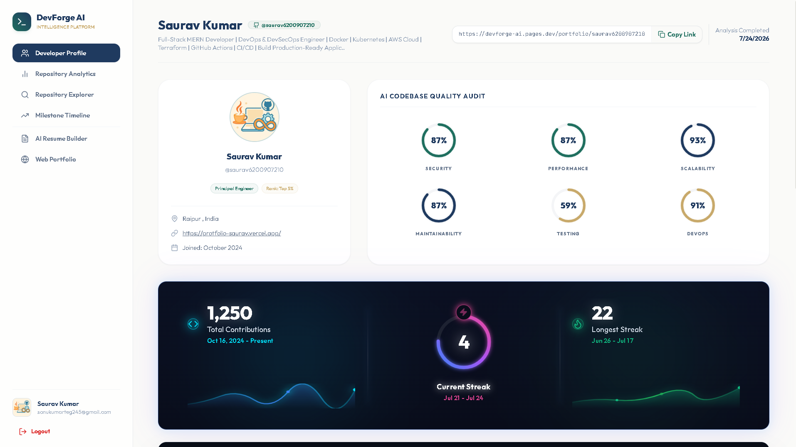 | 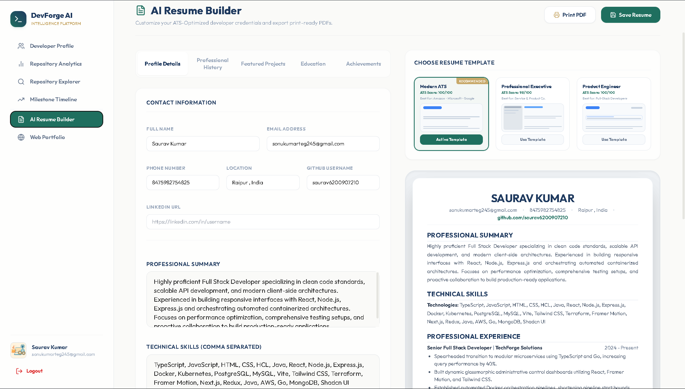 |

| Repository Analytics | Milestone Timeline |
|---|---|
| 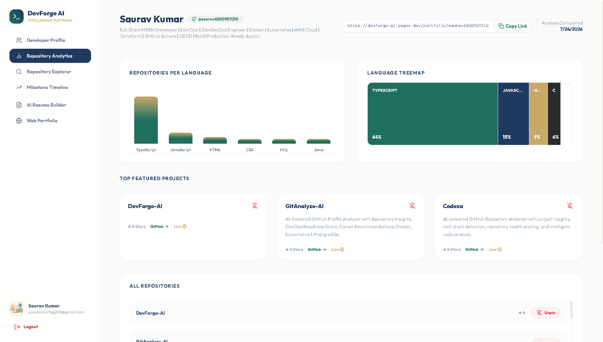 | 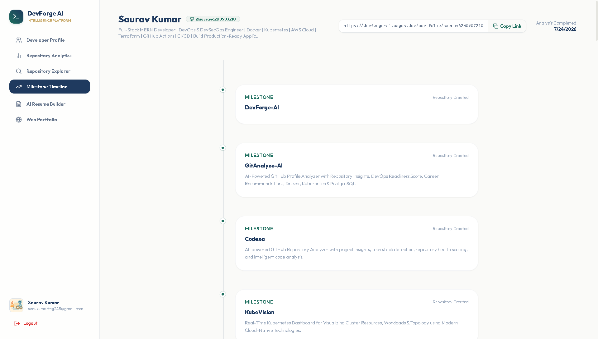 |

These images use repository-relative paths. Ensure the files exist at those exact locations and use matching capitalization.

---

# 🛡️ 36. Security, Reliability & Limitations

ProfileForge AI combines multiple analysis and application workflows. The following considerations help clarify what the platform does and what should be validated before production use.

- 🔐 **Credentials:** Keep private keys and tokens out of source control.
- 🌐 **CORS:** Configure allowed origins according to the intended deployment.
- 📊 **Analysis Accuracy:** Repository scores and detected technologies depend on available data and implemented rules.
- 🤖 **AI Fallback:** Heuristic analysis can provide an alternative when Gemini is unavailable, but may not reproduce the same level of generated insight.
- 🗂️ **Persistence:** JSON-based storage is lightweight but has limitations for concurrent writes and larger deployments.
- 🚀 **Deployment Simulation:** Simulated deployment logs are not proof of a real external deployment.
- 🧪 **Validation:** Verify API behavior, build commands, and production settings against the current repository before release.

---

# 🗺️ 37. Future Enhancements

Potential areas for further development include:

- 📊 More detailed repository quality analytics.
- 🧪 Automated backend and frontend tests.
- 🔐 Expanded security scanning and dependency checks.
- 🗄️ Migration to a production-grade database.
- 📈 Improved job matching and skill prioritization.
- 🚀 Automated deployment pipelines with verified deployment status.
- 📋 Enhanced error reporting and observability.
- 📱 Further improvements to responsive portfolio layouts.

*These are possible future enhancements, not claims that the features are already implemented.*

---

# 📄 38. License

This project is documented as being distributed under the MIT License.

See the [`LICENSE`](LICENSE) file for the applicable terms.

---

# 🤝 39. Contributing

Contributions, suggestions, and bug reports can help improve ProfileForge AI.

1. Fork the repository.
2. Create a feature branch.
3. Implement and test your changes.
4. Submit a pull request with a clear description.

```bash
git checkout -b feature/your-feature
git add .
git commit -m "feat: describe your change"
git push origin feature/your-feature
```

---

# ⭐ 40. Final Project Summary

**ProfileForge AI** brings developer profile analysis, AI-assisted resume generation, job-description matching, skill-gap insights, and shareable portfolio experiences together in one platform.

By combining a React and TypeScript frontend, Node.js and Express backend, Gemini integration, Docker-based packaging, and cloud hosting, the project demonstrates an integrated approach to developer career intelligence.

<p align="center">
  <b>⚡ Analyze Your Code • Optimize Your Resume • Showcase Your Skills • Grow Your Career ⚡</b>
</p>

<p align="center">
  🌐 <a href="https://profileforge1.pages.dev">Live Application</a> •
  💚 <a href="https://profileforge-ye6a.onrender.com/api/health">API Health</a>
</p>

<p align="center">
  <i>Built to help developers turn their technical work into meaningful career insights.</i>
</p>
